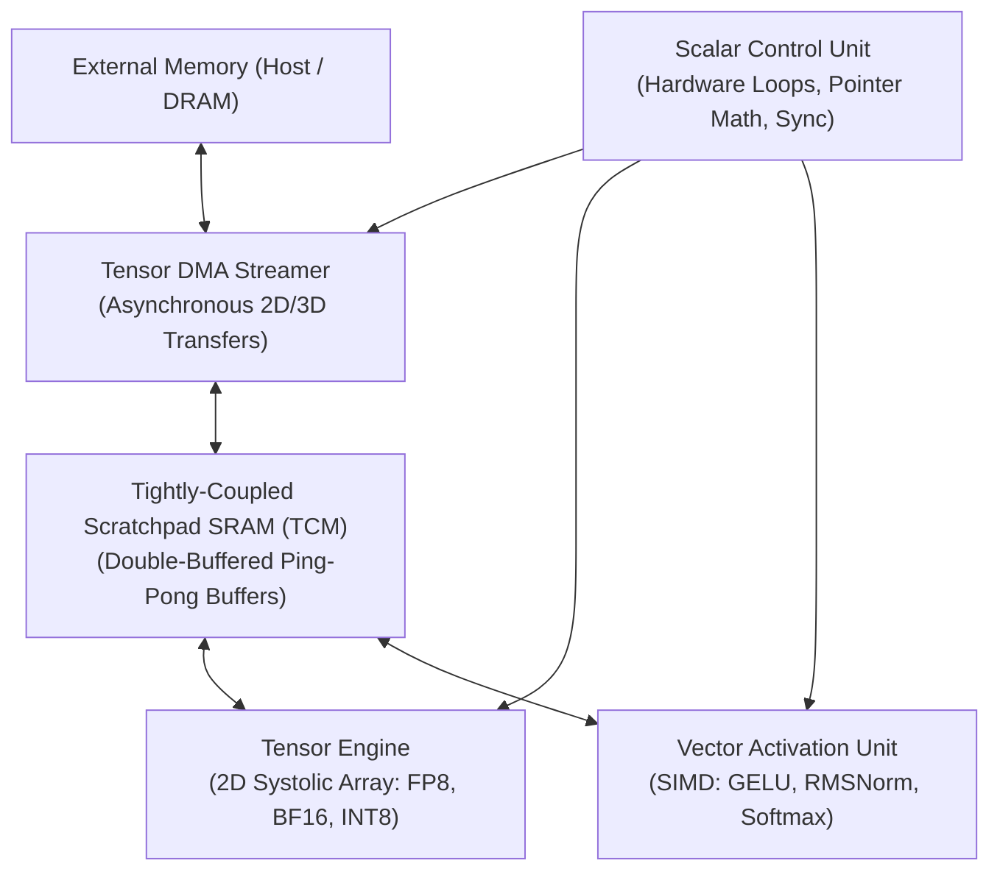

# NeuroFlow: Decoupled Dataflow & Tensor Architecture

[](LICENSE)
[]()

**NeuroFlow** is an open-source, domain-specific processor architecture designed from the ground up for modern deep learning workloads (Transformers, LLMs, and ConvNets).

Instead of shoehorning matrix operations into general-purpose scalar/superscalar cores, NeuroFlow implements a **Decoupled Dataflow and Systolic Tensor Engine** paired with software-managed scratchpad memory, eliminating cache misses, branch prediction penalties, and von Neumann data movement overheads.

---

## 1. Why a New Architecture for AI?

Modern CPUs (x86, ARM, standard RISC-V) were architected for general-purpose computing where control flow is unpredictable and data access patterns are stochastic. When applied to AI workloads, they suffer from fundamental inefficiencies:

1. **The Von Neumann Memory Wall:** Over 80% of energy in traditional cores is consumed simply moving activations and weights between DRAM, cache hierarchies, and registers—not performing arithmetic.
2. **Silicon Waste:** In deep learning, loops and tensor sizes are strictly deterministic. Spending 40%+ of chip die area on complex branch predictors, out-of-order execution (OoO) windows, and speculative execution provides zero benefit for GEMM (General Matrix Multiply).
3. **Cache Inefficiency:** Standard hardware-managed L1/L2/L3 caches with 64-byte line evictions and LRU policies struggle with high-bandwidth tensor streams.

---

## 2. Architectural Blueprint

NeuroFlow decouples control, memory transfers, matrix arithmetic, and non-linear activations into dedicated, cooperating hardware engines:



### Core Components:
* **Scalar Control Unit (SU):** A lean 32-bit execution core responsible for managing tensor descriptors, zero-overhead hardware loops, and inter-unit synchronization.
* **Tensor Engine (TE):** A 2D Systolic Array executing matrix multiply-accumulate (MAC) tiles with zero register-file intermediate stalls.
* **Vector / Activation Unit (VU):** A high-throughput SIMD engine dedicated to element-wise operations that systolic arrays cannot handle: non-linear activations (`GELU`, `SiLU`, `ReLU`) and normalizations (`RMSNorm`, `LayerNorm`, `Softmax`).
* **Tensor DMA Streamer (TDS) & Tightly-Coupled Scratchpad (TCM):** Replaces hardware caches with software-managed SRAM. Supports **double-buffering** (ping-pong buffers): the DMA prefetches the next layer's weights and activations while the Tensor Engine computes on the current tile, hiding 100% of external memory latency.
* **Native Low-Precision Formats:** First-class hardware support for `FP8` (E4M3, E5M2), `BF16` (Bfloat16), `INT8`, and `INT4` with `FP32` accumulation.

---

## 3. Industry Parallels & State of the Art

NeuroFlow's design principles are grounded in the most successful specialized AI silicon in production today:

| System / Pioneer | Key Parallel to NeuroFlow |
| :--- | :--- |
| **Google TPU (v1 - v5p)** | Pioneered 2D Systolic Matrix Units fed directly by high-bandwidth on-chip scratchpad SRAM, offloading activation functions to a paired vector unit. |
| **Tenstorrent Tensix (Jim Keller)** | Decouples data movement from mathematical execution. Replaces unpredictable caches with explicit local SRAM tiles managed by lightweight control processors. |
| **Groq LPU (TSP)** | Proved the superiority of radical determinism: zero branch predictors, zero caches, and compile-time scheduling of every data movement. |
| **NVIDIA TMA (Hopper H100 / Blackwell B200)** | Introduced the *Tensor Memory Accelerator* (TMA) to asynchronously stream multi-dimensional tensor tiles directly from global memory to shared memory without core intervention. |
| **Tesla Dojo (D1 Core)** | Combines a lean scalar controller with a high-density 2D SIMD/matrix array and localized high-bandwidth SRAM per processing node. |

---

## 4. Traditional CPU vs. NeuroFlow

| Feature | Conventional CPU (x86 / RISC-V) | NeuroFlow Architecture |
| :--- | :--- | :--- |
| **Execution Model** | Von Neumann (Fetch $\to$ Decode $\to$ Reg $\to$ ALU) | **Decoupled Dataflow & Systolic Matrix Engine** |
| **Memory Hierarchy** | Dynamic L1/L2/L3 caches (unpredictable misses) | **Explicit Scratchpad SRAM + Double-Buffered DMA** |
| **Matrix Operations** | Emulated through nested loops of scalar/SIMD ops | **Hardware Tile Primitive (`TMATMUL`)** |
| **Branch Handling** | Large speculative branch predictor & OoO logic | **Zero-overhead Hardware Loop Controller** |
| **AI Datatypes** | Prioritizes FP32 / FP64 (FP8/BF16 via extensions) | **Native FP8 (E4M3/E5M2), BF16, INT8, INT4** |
| **Latency Hiding** | Speculative out-of-order execution | **Asynchronous Decoupled Access-Execute (DAE)** |

---

## 5. Development Roadmap

- [ ] **Phase 1: Architecture Specification**
  - [ ] Formal 32-bit ISA definition (`isa_spec.md`)
  - [ ] Memory model & scratchpad address mapping (`memory_model.md`)
  - [ ] Systolic array dimensions and tiling scheme
- [ ] **Phase 2: Cycle-Accurate Software Emulator**
  - [ ] Rust-based core emulator (`emulator/`)
  - [ ] Instruction decoder and execution pipeline
  - [ ] Systolic matrix engine simulation with tile buffering
  - [ ] Cycle counter, energy estimation, and throughput metrics
- [ ] **Phase 3: Assembler & Toolchain**
  - [ ] Lightweight assembler to compile `.s` assembly files to NeuroFlow machine code
  - [ ] Disassembler and binary inspector
- [ ] **Phase 4: Neural Network Benchmark**
  - [ ] End-to-end execution of a complete Transformer block (GEMM + RMSNorm + SiLU + Softmax)
- [ ] **Phase 5: Hardware Description (RTL)**
  - [ ] SystemVerilog / Chisel implementation
  - [ ] Verilator simulation and FPGA deployment

---

## 6. Repository Layout

```text
neuroflow/
├── README.md               # Architecture overview and design philosophy
├── docs/                   # Formal ISA and microarchitecture specifications
│   ├── isa_spec.md         # Instruction Set Architecture manual
│   └── memory_model.md     # Scratchpad, DMA descriptors, and memory map
├── emulator/               # Rust-based cycle-accurate functional emulator
├── asm/                    # Assembly kernels and workload benchmarks
└── rtl/                    # Hardware description files (SystemVerilog / Chisel)
```

---

## License

This project is licensed under the MIT License - see the [LICENSE](LICENSE) file for details.
