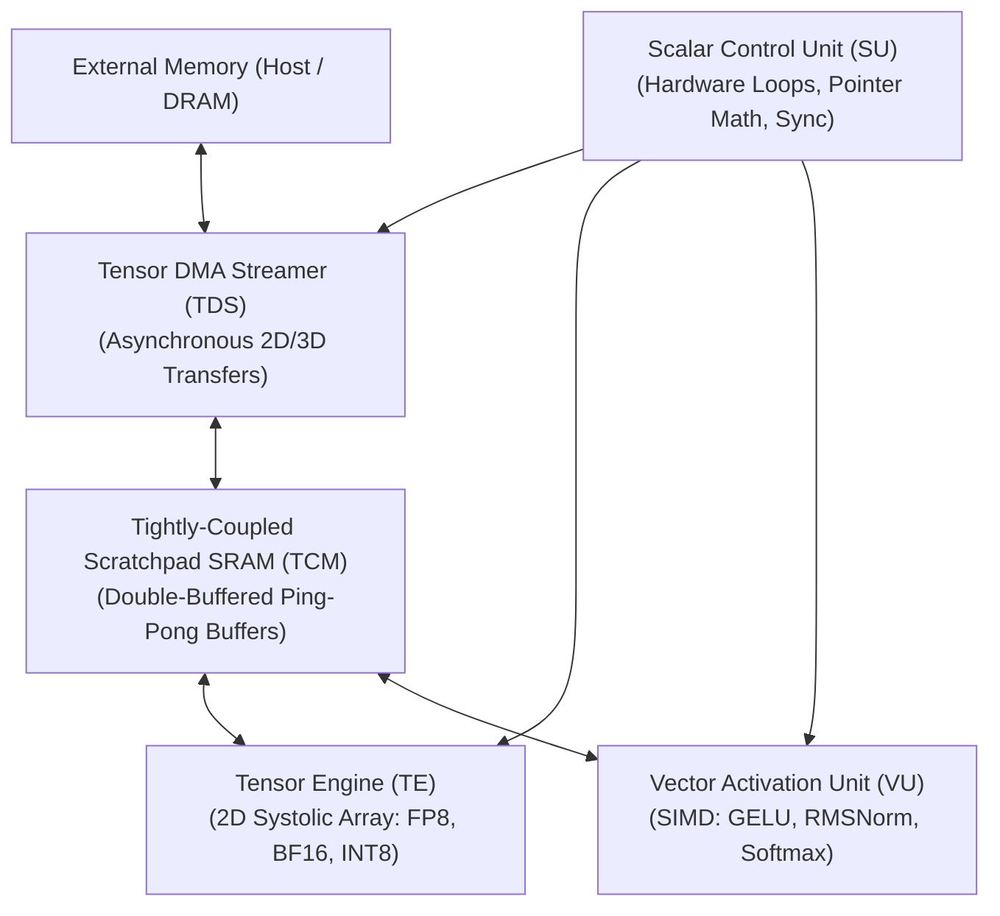

# NeuroFlow: A Decoupled Access-Execute Neural Processing Unit (DAE-NPU)

[](LICENSE)
[]()
[]()

**NeuroFlow** is an open-source, domain-specific processor architecture designed from the ground up for modern deep learning workloads (Transformers, LLMs, and ConvNets).

NeuroFlow is formally classified as a **Decoupled Access-Execute Neural Processing Unit (DAE-NPU)**. By strictly decoupling memory streaming (Access) from matrix/vector computation (Execute) and coordinating them via an ultra-lean 32-bit scalar control core, NeuroFlow eliminates the von Neumann bottleneck, removes unpredictable cache misses, and maximizes compute density per watt.

> For a complete architectural breakdown and theoretical foundation, read [docs/architecture.md](docs/architecture.md).

---

## 1. Why a DAE-NPU for AI?

Modern CPUs (x86, ARM, standard RISC-V) were architected for general-purpose computing where control flow is unpredictable and data access patterns are stochastic. When applied to AI workloads, they suffer from fundamental inefficiencies:

1. **The Von Neumann Memory Wall:** Over 80% of energy in traditional cores is consumed simply moving activations and weights between DRAM, cache hierarchies, and registers—not performing arithmetic.
2. **Silicon Waste:** In deep learning, loops and tensor sizes are strictly deterministic. Spending 40%+ of chip die area on complex branch predictors, out-of-order execution (OoO) windows, and speculative execution provides zero benefit for GEMM (General Matrix Multiply).
3. **Cache Inefficiency:** Standard hardware-managed L1/L2/L3 caches with 64-byte line evictions and LRU policies struggle with high-bandwidth tensor streams.

---

## 2. Industry Parallels: Synthesis of the State of the Art

Every major AI accelerator today excels at one or two dimensions of the AI problem, but carries severe legacy trade-offs:

```
+------------------------------------------------------------------------------------+
|                               THE MODERN AI ACCELERATOR MATRIX                      |
+-------------------+--------------------------------+-------------------------------+
| Architecture      | What It Got Right              | The Historical Baggage        |
+-------------------+--------------------------------+-------------------------------+
| NVIDIA Blackwell  | Asynchronous Tensor DMA (TMA)  | Trapped inside a legacy SIMT  |
| / Hopper (H100)   | and high-density Tensor Cores  | GPU; warp schedulers, dynamic |
|                   |                                | bank conflicts, huge L2 cache.|
+-------------------+--------------------------------+-------------------------------+
| Google TPU        | 2D Systolic Matrix Unit +      | Massive VLIW bundles (100s of |
| (v2 - v5p)        | Scratchpad + Vector Unit       | bits); closed coprocessor     |
|                   |                                | slave to a host x86 CPU.      |
+-------------------+--------------------------------+-------------------------------+
| Tenstorrent       | Decentralized core with local  | Micro-core sprawl: 5 separate |
| Tensix Core       | SRAM tiles and decoupled math  | RISC-V CPUs inside *each* core|
| (Jim Keller)      |                                | creating firmware complexity. |
+-------------------+--------------------------------+-------------------------------+
| Groq LPU          | Total determinism; zero caches | Destroyed the concept of an   |
| (TSP)             | and zero branch predictors     | ISA; spatial routing makes it |
|                   |                                | impossible to program by hand.|
+-------------------+--------------------------------+-------------------------------+
| NeuroFlow         | DAE: Pure Tensor DMA Streamer  | None. Built clean-slate as an |
| (This Project)    | + 2D Systolic GEMM + Scratchpad| open 32-bit DAE-NPU with      |
|                   | TCM + Lean 32-bit Scalar ISA   | hardware loops.               |
+-------------------+--------------------------------+-------------------------------+
```

NeuroFlow synthesizes the best of these innovations into a clean, open design:
* **The Matrix Core of Google TPU:** 2D Systolic Array performing massive MAC operations directly in hardware.
* **The Streaming Engine of NVIDIA TMA:** Asynchronous, multidimensional tensor DMA streaming directly to scratchpad memory.
* **The Predictability of Groq LPU:** Tightly-Coupled Scratchpad Memory (TCM) with zero cache misses.
* **The Simplicity of Classic RISC:** A single, clean 32-bit ISA with zero-overhead hardware loops.

---

## 3. Architectural Blueprint

NeuroFlow divides execution into four cooperating, decoupled domains:



### Core Components:
* **Scalar Control Unit (SU):** A lean 32-bit execution core responsible for managing tensor descriptors, zero-overhead hardware loops, and inter-unit synchronization.
* **Tensor Engine (TE):** A 2D Systolic Array executing matrix multiply-accumulate (MAC) tiles with zero register-file intermediate stalls.
* **Vector / Activation Unit (VU):** A high-throughput SIMD engine dedicated to element-wise operations that systolic arrays cannot handle: non-linear activations (`GELU`, `SiLU`, `ReLU`) and normalizations (`RMSNorm`, `LayerNorm`, `Softmax`).
* **Tensor DMA Streamer (TDS) & Tightly-Coupled Scratchpad (TCM):** Replaces hardware caches with software-managed SRAM. Supports **double-buffering** (ping-pong buffers): the DMA prefetches the next layer's weights and activations while the Tensor Engine computes on the current tile, hiding 100% of external memory latency.
* **Native Low-Precision Formats:** First-class hardware support for `FP8` (E4M3, E5M2), `BF16` (Bfloat16), `INT8`, and `INT4` with `FP32` accumulation.

---

## 4. Traditional CPU vs. NeuroFlow DAE-NPU

| Feature | Conventional CPU (x86 / RISC-V) | NeuroFlow DAE-NPU |
| :--- | :--- | :--- |
| **Execution Model** | Von Neumann (Fetch $\to$ Decode $\to$ Reg $\to$ ALU) | **Decoupled Access-Execute (DAE) & Systolic Array** |
| **Memory Hierarchy** | Dynamic L1/L2/L3 caches (unpredictable misses) | **Explicit Scratchpad SRAM + Double-Buffered DMA** |
| **Matrix Operations** | Emulated through nested loops of scalar/SIMD ops | **Hardware Tile Primitive (`TMATMUL`)** |
| **Branch Handling** | Large speculative branch predictor & OoO logic | **Zero-Overhead Hardware Loop Controller** |
| **AI Datatypes** | Prioritizes FP32 / FP64 (FP8/BF16 via extensions) | **Native FP8 (E4M3/E5M2), BF16, INT8, INT4** |
| **Latency Hiding** | Speculative out-of-order execution | **Asynchronous Decoupled Access-Execute (DAE)** |

---

## 5. Core Architectural Tenets (Mandatory Design Criteria)

Every architectural decision, RTL module, and emulator component **must** strictly adhere to these five tenets:

1. **Tenet I: Physics First (Compute-to-Energy Symmetry):** Data movement consumes up to 100× more energy than math. Partial sums remain stationary inside accumulator tiles; intermediate DRAM roundtrips are strictly forbidden.
2. **Tenet II: Radical Determinism Over Speculative Hardware:** AI graphs are statically known. Zero silicon budget is spent on branch predictors or out-of-order buffers; execution relies on zero-overhead hardware loops and explicit DMA.
3. **Tenet III: Strict Decoupling of Access and Execute (DAE):** Memory streaming operates asynchronously from the compute pipelines. Double-buffered scratchpad SRAM completely hides memory latency.
4. **Tenet IV: Dimensional Alignment (Tile & Vector Symmetry):** A $16 \times 16$ tile row in FP32 equals 512 bits. Vector registers are exactly 512 bits wide, enabling 1-cycle transfers between matrix accumulators and activation units with zero shuffling.
5. **Tenet V: Anti-Bloat / Lean 32-bit Fixed Encoding:** All instructions are strictly 32-bit fixed width and 4-byte aligned, ensuring simple, high-frequency, low-power decoders.

---

## 6. Development Roadmap

- [x] **Phase 1: Architecture Specification & DAE Foundations**
  - [x] High-level architectural overview & DAE paradigm ([docs/architecture.md](docs/architecture.md))
  - [x] Formal 32-bit ISA definition & register mapping ([docs/isa_spec.md](docs/isa_spec.md))
  - [x] Core architectural tenets & rationale table
- [x] **Phase 2: Cycle-Accurate Software Emulator (`emulator/`)**
  - [x] Rust-based core engine, machine state, and memory subsystem (Scratchpad TCM + DRAM)
  - [x] 32-bit instruction fetcher and decoder
  - [x] Asynchronous Tensor DMA Streamer (TDS) with ping-pong double buffering
  - [x] 2D Systolic Array Tensor Engine ($16 \times 16$ tiles: FP8, BF16, INT8, FP32)
  - [x] SIMD Vector Engine (`VGELU`, `VRMSNORM`, `VSOFTMAX`, `VADD`, `VMUL`, `VROW.LOAD`, `VROW.STORE`)
  - [x] Cycle counter, MAC throughput metrics, and execution reporting
- [x] **Phase 3: Assembler & Toolchain (`assembler/`)**
  - [x] Two-pass assembler (`neuroflow-as`) compiling `.s` files into 32-bit machine code (`.bin`)
  - [x] Verilog hex memory file generator (`--hex .hex` for `$readmemh`)
  - [x] Direct binary execution support in the emulator (`cargo run -p emulator -- <binary.bin>`)
- [x] **Phase 4: Neural Network Benchmark (`benchmarks/`)**
  - [x] End-to-end execution of a complete Transformer block (Q/K/V Projections + Softmax Attention + RMSNorm + MLP + Residuals)
  - [x] Bit-for-bit numerical validation against NumPy golden reference model
  - [x] Benchmark metrics: 24,576 Systolic MACs in 433 cycles (56.76 MACs/cycle)
- [x] **Phase 5: Hardware Description (RTL in `rtl/`)**
  - [x] Synthesizable SystemVerilog Processing Element (`pe.sv`)
  - [x] 2D Systolic Array Mesh ($16 \times 16$ PEs with 512-bit readout bus in `systolic_array.sv`)
  - [x] 512-bit SIMD Vector Engine (`vector_unit.sv`)
  - [x] Verilator C++ testbench harness (`tb/tb_pe.cpp`, `tb/tb_systolic.cpp`) with VCD waveform tracing
  - [x] Full hardware verification: 4,096 MACs in 50 cycles (81.9 MACs/cycle sustained)
- [ ] **Phase 4: Neural Network Benchmark**
  - [ ] End-to-end execution of a complete Transformer block (GEMM + RMSNorm + SiLU + Softmax)
  - [ ] Validation against PyTorch reference outputs
- [ ] **Phase 5: Hardware Description (RTL in `rtl/`)**
  - [ ] SystemVerilog / Chisel implementation of the DAE-NPU
  - [ ] Verilator cycle-accurate simulation and FPGA deployment

---

## 7. Quick Start: Assembling & Running Programs

### 1. Compile an Assembly Source File
```bash
# Assemble human-readable assembly (.s) into a 32-bit binary (.bin) and Verilog hex (.hex)
cargo run -p assembler -- asm/gemm_layer.s -o asm/gemm_layer.bin --hex asm/gemm_layer.hex
```

### 2. Execute on the DAE-NPU Emulator
```bash
# Execute the compiled binary on the cycle-accurate emulator
cargo run -p emulator -- asm/gemm_layer.bin
```

### 3. Run Hardware RTL Simulation (SystemVerilog + Verilator)
```bash
# Install Verilator (if not already installed)
sudo pacman -S verilator gtkwave

# Run RTL simulation of the Systolic Processing Element
cd rtl
make sim_pe
```

---

## 8. Repository Layout

```text
neuroflow/
├── README.md               # Architecture overview, industry comparison, and roadmap
├── docs/                   # Formal ISA and microarchitecture specifications
│   ├── architecture.md     # In-depth DAE-NPU architectural analysis and industry matrix
│   ├── isa_spec.md         # Instruction Set Architecture manual
│   └── memory_model.md     # Scratchpad, DMA descriptors, and memory map
├── emulator/               # Rust-based cycle-accurate functional emulator
├── asm/                    # Assembly kernels and workload benchmarks
└── rtl/                    # Hardware description files (SystemVerilog / Chisel)
```

---

## License

This project is licensed under the MIT License - see the [LICENSE](LICENSE) file for details.
