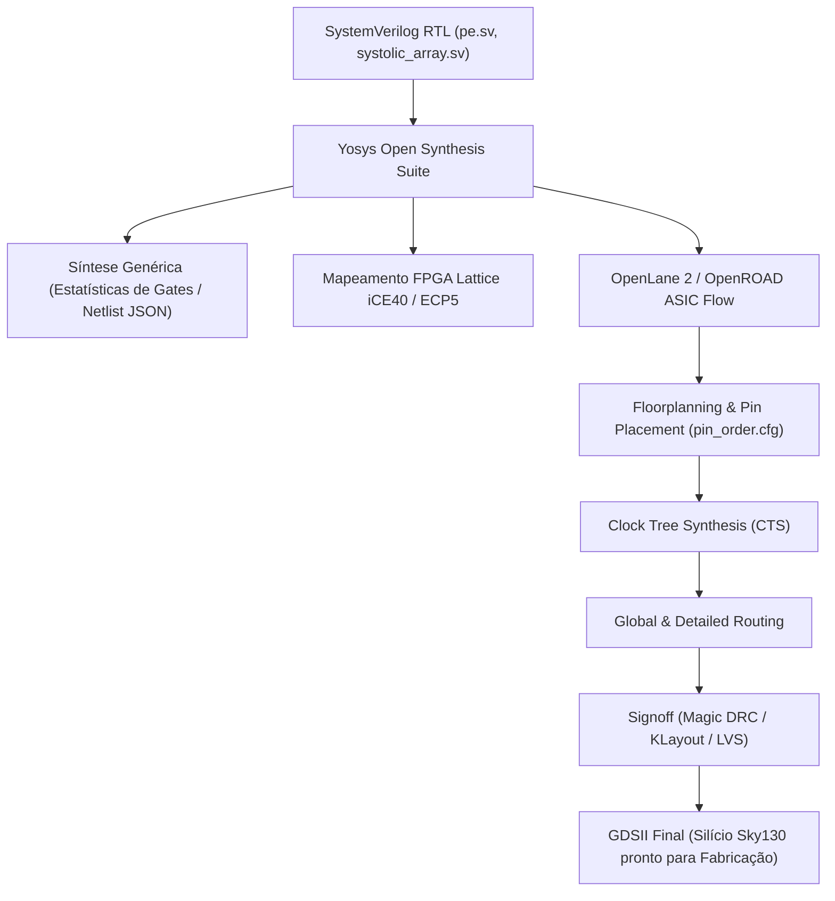

# NeuroFlow: Fluxo de Síntese Lógica e Fabricação de Chips (ASIC)

Este documento descreve como executar o **Fluxo 3 (Open-Source Logic Synthesis & ASIC Flow)** no NeuroFlow, transformando os módulos SystemVerilog em portas lógicas, mapeamentos para FPGAs abertos ou silício real (GDSII) usando o processo **SkyWater 130nm**.

---

## 1. Visão Geral do Fluxo



---

## 2. Parte 1: Síntese Lógica com Yosys

O **Yosys** analisa o SystemVerilog sintetizável, infere registradores, detecta multiplexadores e mapeia as operações aritméticas (como o multiplicador do PE) para portas lógicas ou DSPs.

### Instalação no Omarchy / Arch Linux

Abra seu terminal e execute:

```bash
sudo pacman -S yosys
```

*(Opcional: para visualização de esquemáticos lógicos em interface gráfica, instale também `sudo pacman -S graphviz xdot`).*

### Comandos de Síntese Disponíveis

Na pasta `rtl/`:

```bash
cd rtl

# 1. Síntese Lógica Genérica do Processing Element (PE)
make synth_pe

# 2. Mapeamento para FPGA Lattice iCE40 (LUTs e DSPs MAC16)
make synth_ice40

# 3. Mapeamento para FPGA Lattice ECP5
make synth_ecp5
```

### Arquivos Gerados (`rtl/obj_dir/`):
* `pe_synth_netlist.v`: Netlist Verilog em nível de portas (*gate-level netlist*).
* `pe_synth.json`: Representação estrutural em JSON, ideal para visualizadores esquemáticos web (como `netlistsvg`).

---

## 3. Parte 2: Síntese Física de Silício com OpenLane (SkyWater 130nm)

O **OpenLane** é o fluxo automatizado de RTL-to-GDSII baseado no OpenROAD. Ele pega o código Verilog e executa todas as etapas físicas de fabricação:
1. Síntese lógica com a biblioteca de células padrão `sky130_fd_sc_hd`.
2. *Floorplanning* com posicionamento físico determinístico dos pinos (`openlane/pe/pin_order.cfg`).
3. Posicionamento de células (*Placement*) e síntese da árvore de clock (*CTS*).
4. Roteamento de trilhas de metal (*Routing*).
5. Verificação de regras de design (*Magic DRC* e *KLayout*).

### Configuração do Módulo PE

Os arquivos de configuração do chip estão em `openlane/pe/`:
* [config.json](file:///home/marcelo/Work/neuroflow/openlane/pe/config.json): Parâmetros do chip (Clock: 10ns / 100MHz, Densidade de células: 50%, PDK: Sky130).
* [pin_order.cfg](file:///home/marcelo/Work/neuroflow/openlane/pe/pin_order.cfg): Garante que as ativações cheguem pelo lado Oeste (West) e saiam pelo Leste (East), enquanto os pesos chegam pelo Norte (North) e saem pelo Sul (South), respeitando a física 2D do array sistólico.

### Executando o Fluxo ASIC

Com o ambiente configurado, você pode rodar diretamente via Makefile ou chamando o CLI do OpenLane 2:

```bash
# Opção 1: Via Makefile
cd rtl
make asic_pe

# Opção 2: Diretamente via OpenLane 2 CLI
./.venv/bin/openlane --dockerized openlane/pe/config.json
```

Ao término, o layout GDSII e os relatórios completos de timing, área e consumo de potência estarão disponíveis em `openlane/pe/runs/`.

